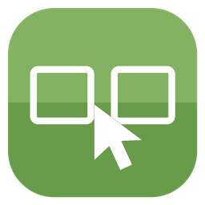
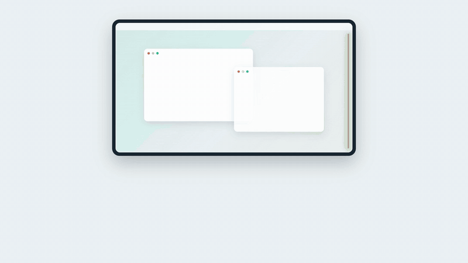
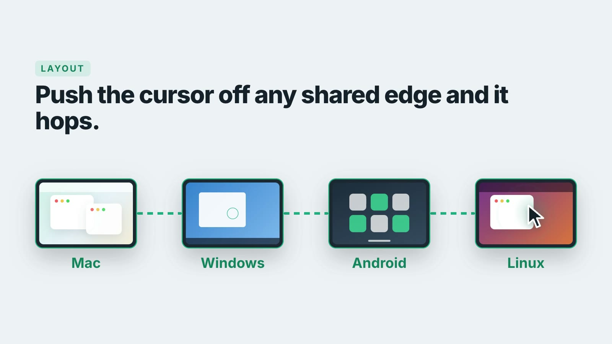
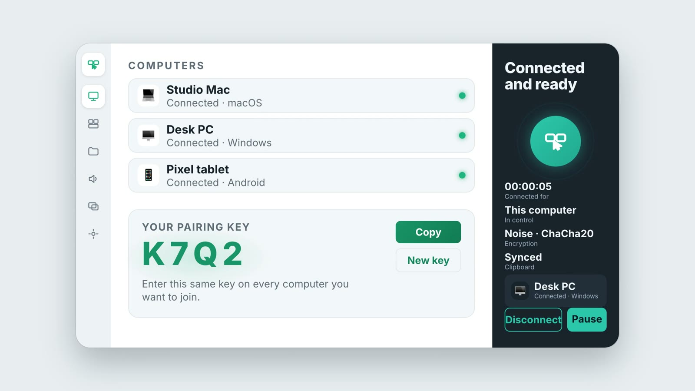

 

# Screen Hopper

### One mouse. Four computers.

**Push your cursor off the edge of a screen and it hops to the next computer.** 
Mouse, keyboard, clipboard and files. All on your own network.

A free, open-source **software KVM**: share one mouse and keyboard across multiple computers. 
A Synergy, Barrier and Input Leap alternative, built with Rust and Tauri.

 

 

**[Features](#what-it-does)** &nbsp;·&nbsp; **[How it works](#how-it-works)** &nbsp;·&nbsp; **[Platforms](#platforms)**

 

---

## The idea

You have more than one computer on your desk. You should not need more than one mouse.

Arrange your screens the way they sit on your desk, push the cursor off the edge of one, and it appears on the other. The keyboard follows. So do your copied text and your files.

---

## What it does

<table>
<tr>
<td width="50%" valign="top">

### 🖱️ Edge hopping
Drag the screens in **Layout** to match your desk, like Windows display settings. Push the cursor off any shared edge and it hops. It even hops between two *other* computers.

</td>
<td width="50%" valign="top">

### ⌨️ Keyboard follows
Type on whichever computer the cursor is on. Cmd and Ctrl can be swapped between Mac and Windows, so Cmd+C and Ctrl+C both copy.

</td>
</tr>
<tr>
<td valign="top">

### 📋 Shared clipboard
Text, rich text and images. Copy on one computer, paste on another. Copied files travel too.

</td>
<td valign="top">

### 📁 File transfer
Drop files or folders onto a computer, or copy in Finder or Explorer and paste on the other side. Received files land in a folder you choose.

</td>
</tr>
<tr>
<td valign="top">

### 🌗 Dim and pause
Dim the screen that is not in control. Pause hopping from the app, or hit the panic shortcut <kbd>Ctrl</kbd> <kbd>Alt</kbd> <kbd>Shift</kbd> <kbd>Esc</kbd> to take the cursor back.

</td>
<td valign="top">

### 🔒 Private by design
Everything is encrypted end to end and never leaves your local network. No account, no cloud, no server.

</td>
</tr>
</table>

The Computers tab. Same pairing key on every computer, and they find each other.

---

## How it works

1. **Install Screen Hopper on each computer** and open it.
2. **Use the same pairing key** on all of them. Computers on the same network find each other automatically (or connect by IP).
3. **Arrange your screens** in the Layout tab.
4. **Push the cursor off an edge.** That's it.

---

## Platforms

| | Platform | What it does | Notes |
|---|---|---|---|
| 🍎 | **macOS** | Menu-bar app. Full control both ways. | Needs Accessibility and Input Monitoring. |
| 🪟 | **Windows** | Installer (NSIS). Full control both ways. | Unsigned, so SmartScreen may warn. The pause shortcut is Mac-only. |
| 🐧 | **Linux** | `.deb` for Wayland (GNOME 46+, KDE Plasma 6.1+). | See [LINUX.md](LINUX.md). |
| 🤖 | **Android** | Your computers' mouse and keyboard hop onto the phone or tablet. | Receive side only. See [ANDROID.md](ANDROID.md). |

> **Honest status:** macOS is the most tested. The Windows, Linux and Android builds are newer and have seen less real-world use, so expect rough edges and please report them.

More detail: [Linux](LINUX.md) · [Android](ANDROID.md)

---

## License

MIT. Free to use, change and share. See [LICENSE](LICENSE).

 Screen Hopper 1.0.0

